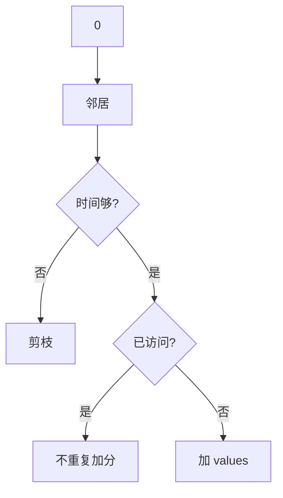

# LC 2065. Maximum Path Quality of a Graph

> Hard · [LeetCode](https://leetcode.com/problems/maximum-path-quality-of-a-graph/) · Tags: Array, Backtracking, Graph

## 题意

无向带权图，从 `0` 出发并在 `maxTime` 内回到 `0`。路径质量为**首次访问**节点 `values` 之和。求最大质量。

## 最优思路

`n ≤ 22` 且边少，DFS 回溯：维护剩余时间、当前质量、已访问集合；节点值只在首次进入时计入。每次回到 `0` 更新答案。

## 图解

## 复杂度

| 项 | 值 |
|----|----|
| 时间 | 指数级（图小可接受） |
| 空间 | \(O(n)\) |

## 代码

见 `2065.maximum-path-quality-of-a-graph.py`。
