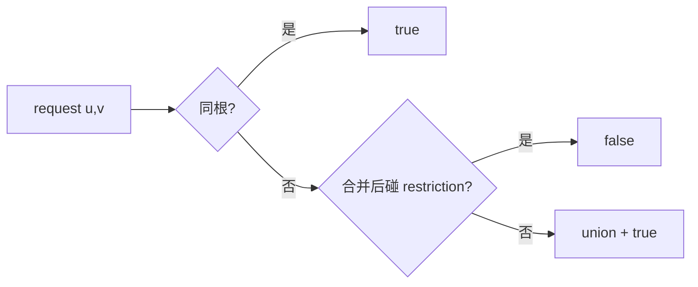

# LC 2076. Process Restricted Friend Requests

> Hard · [LeetCode](https://leetcode.com/problems/process-restricted-friend-requests/) · Tags: Union-Find, Graph

## 题意

`n` 人，若干禁止成为朋友的对。按顺序处理好友请求：若成功则永久成为朋友（传递）；若会使某对禁止双方落入同一连通块则拒绝。返回每个请求是否成功。

## 最优思路

并查集维护已通过好友关系。对请求 `(u,v)`，若已同根则直接成功；否则检查每条 restriction：两端根是否恰好是 `find(u)` 与 `find(v)` 的两端，是则拒绝，否则合并。

## 图解

## 复杂度

| 项 | 值 |
|----|----|
| 时间 | \(O(q\cdot r\cdot\alpha(n))\) |
| 空间 | \(O(n)\) |

## 代码

见 `2076.process-restricted-friend-requests.py`。
