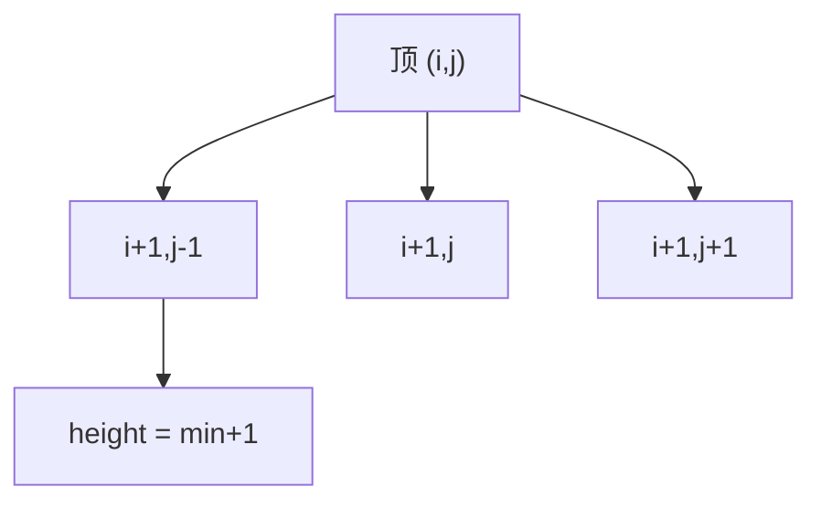

# LC 2088. Count Fertile Pyramids in a Land

> Hard · [LeetCode](https://leetcode.com/problems/count-fertile-pyramids-in-a-land/) · Tags: Array, Dynamic Programming, Matrix

## 题意

`grid` 中 `1` 为肥沃格。统计正金字塔与倒金字塔个数（高度 ≥ 2，每层左右扩展一格且全为 `1`）。

## 最优思路

`dp[i][j]` = 以 `(i,j)` 为顶、向下扩展的最大高度。自底向上：`dp[i][j] = min(下方三格)+1`（若为肥沃）。贡献 `dp-1`。倒金字塔对网格上下翻转后再算一次。

## 图解

## 复杂度

| 项 | 值 |
|----|----|
| 时间 | \(O(mn)\) |
| 空间 | \(O(mn)\) |

## 代码

见 `2088.count-fertile-pyramids-in-a-land.py`。
