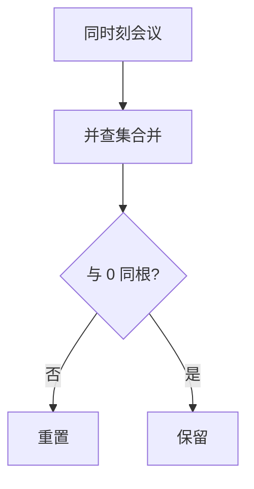

# LC 2092. Find All People With Secret

> Hard · [LeetCode](https://leetcode.com/problems/find-all-people-with-secret/) · Tags: Union-Find, Graph, Sorting

## 题意

0 号知密，并告诉 `firstPerson`。同一时刻开会者两两可传密（连通分量即时传播）。返回最终知密者。

## 最优思路

会议按时间分组。每组内并查集合并；组结束后，未与 0 同连通的人重置父指针（密未传到）。

## 图解

## 复杂度

| 项 | 值 |
|----|----|
| 时间 | \(O(m\log m + n\alpha)\) |
| 空间 | \(O(n)\) |

## 代码

见 `2092.find-all-people-with-secret.py`。
