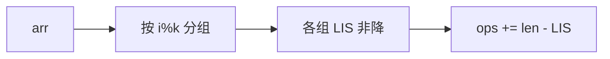

# LC 2111. Minimum Operations to Make the Array K-Increasing

> Hard · [LeetCode](https://leetcode.com/problems/minimum-operations-to-make-the-array-k-increasing/) · Tags: Array, Binary Search, LIS

## 题意

一次操作可把任意位置改成任意值。使数组满足 `arr[i] ≤ arr[i+k]`（对所有合法 `i`）的最少操作数。

## 最优思路

`mod k` 同余类互不影响。对每个 residual 子序列求最长**非降**子序列长度（`bisect_right`），操作数 = 长度 − LIS。总和即答案。

## 图解

## 复杂度

| 项 | 值 |
|----|----|
| 时间 | \(O(n\log n)\) |
| 空间 | \(O(n/k)\) |

## 代码

见 `2111.minimum-operations-to-make-the-array-k-increasing.py`。
