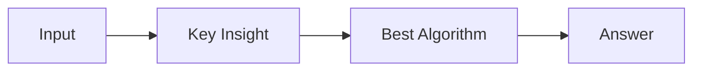

# LC 2123. Minimum Operations to Remove Adjacent Ones in Matrix

> Hard · [LeetCode](https://leetcode.com/problems/minimum-operations-to-remove-adjacent-ones-in-matrix/) · Tags: Array, Depth-First Search, Graph Theory, Matrix, Edmonds–Karp Algorithm, MPM Algorithm, Push-Relabel Algorithm, Flow Network, Dinic's Algorithm

## 题意

（待补：一句话题意）

## 最优思路

（待补：最优解核心 intuition）

## 图解

## 复杂度

| 项 | 值 |
|----|----|
| 时间 | TBD |
| 空间 | TBD |

## 代码

见同目录 `2123.minimum-operations-to-remove-adjacent-ones-in-matrix.py`。

## 参考

- https://leetcode.com/problems/minimum-operations-to-remove-adjacent-ones-in-matrix/
