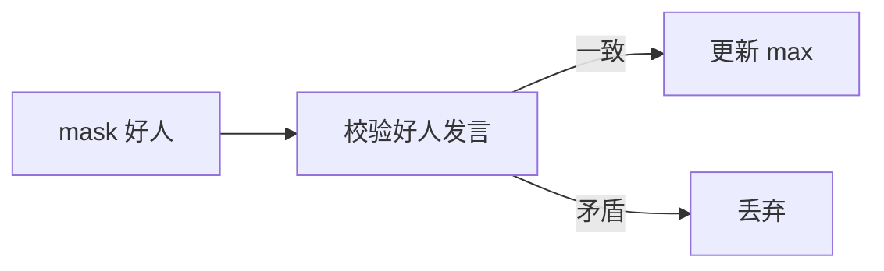

# LC 2151. Maximum Good People Based on Statements

> Hard · [LeetCode](https://leetcode.com/problems/maximum-good-people-based-on-statements/) · Tags: Array, Backtracking, Bit Manipulation, Enumeration

## 题意

`statements[i][j]`：`0` 说 j 坏，`1` 说 j 好，`2` 无发言。好人说话全真，坏人可真可假。求最多可能的好人数。

## 最优思路

枚举好人集合 bitmask（`n ≤ 15`）。仅校验好人的发言与假设一致；坏人发言忽略。取合法 mask 的最大 popcount。

## 图解

## 复杂度

| 项 | 值 |
|----|----|
| 时间 | \(O(2^n n^2)\) |
| 空间 | \(O(1)\) |

## 代码

见 `2151.maximum-good-people-based-on-statements.py`。
