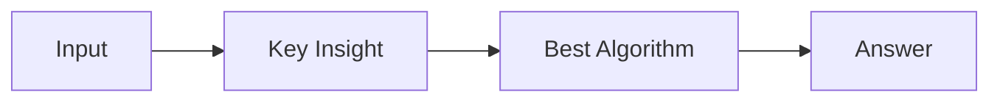

# LC 2156. Find Substring With Given Hash Value

> Hard · [LeetCode](https://leetcode.com/problems/find-substring-with-given-hash-value/) · Tags: String, Sliding Window, Rolling Hash, Hash Function

## 题意

（待补：一句话题意）

## 最优思路

（待补：最优解核心 intuition）

## 图解

## 复杂度

| 项 | 值 |
|----|----|
| 时间 | TBD |
| 空间 | TBD |

## 代码

见同目录 `2156.find-substring-with-given-hash-value.py`。

## 参考

- https://leetcode.com/problems/find-substring-with-given-hash-value/
