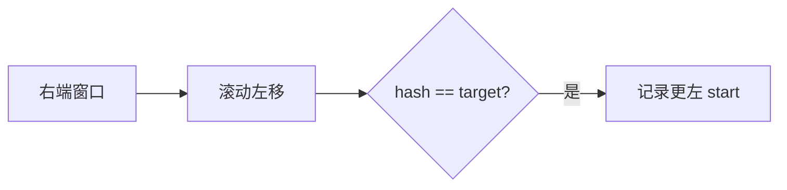

# LC 2156. Find Substring With Given Hash Value

> Hard · [LeetCode](https://leetcode.com/problems/find-substring-with-given-hash-value/) · Tags: String, Sliding Window, Rolling Hash

## 题意

哈希定义为 \(\sum_{j=0}^{k-1} \mathrm{val}(s[i+j])\cdot power^j \bmod modulo\)（最左字符 \(power^0\)）。求第一个（最左）长度为 `k` 且哈希等于 `hashValue` 的子串。

## 最优思路

从右往左滚动：先算末窗子串哈希，再每次去掉右端、整体乘 `power`、加上新左端。这样 \(power^{k-1}\) 始终对应窗口最右字符。保留最左匹配起点。

## 图解

## 复杂度

| 项 | 值 |
|----|----|
| 时间 | \(O(n)\) |
| 空间 | \(O(1)\) |

## 代码

见 `2156.find-substring-with-given-hash-value.py`。
