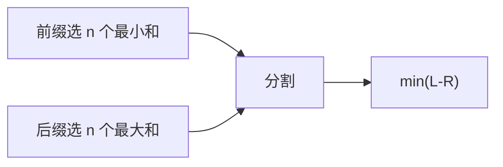

# LC 2163. Minimum Difference in Sums After Removal of Elements

> Hard · [LeetCode](https://leetcode.com/problems/minimum-difference-in-sums-after-removal-of-elements/) · Tags: Array, Heap, DP

## 题意

长度 `3n` 数组，删 `n` 个后前一半和 − 后一半和尽量小。

## 最优思路

枚举分割点：左边取 `n` 个最小和（大根堆维护），右边取 `n` 个最大和（小根堆），最小化 `left - right`。

## 图解

## 复杂度

| 项 | 值 |
|----|----|
| 时间 | \(O(n\log n)\) |
| 空间 | \(O(n)\) |

## 代码

见 `2163.minimum-difference-in-sums-after-removal-of-elements.py`。
