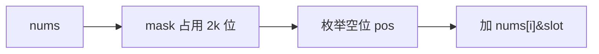

# LC 2172. Maximum AND Sum of Array

> Hard · [LeetCode](https://leetcode.com/problems/maximum-and-sum-of-array/) · Tags: Array, Dynamic Programming, Bit Manipulation, Bitmask

## 题意

把 `nums` 全部放入编号 `1..numSlots` 的篮子，每篮至多 2 个数，最大化 \(\sum (\textit{num} \land \textit{slot})\)。

## 最优思路

每个篮子拆成 2 个位置，共 `2*numSlots ≤ 18` 位，用 mask 表示占用。按放入顺序对下一个数枚举空位：贡献 `nums[i] & (pos//2+1)`。记忆化 DP。

## 图解

## 复杂度

| 项 | 值 |
|----|----|
| 时间 | \(O(n\cdot 2^{2k})\)，\(k=\textit{numSlots}\) |
| 空间 | \(O(2^{2k})\) |

## 代码

见 `2172.maximum-and-sum-of-array.py`。
