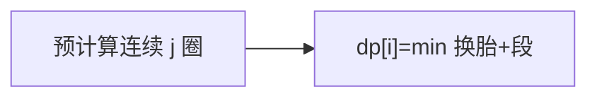

# LC 2188. Minimum Time to Finish the Race

> Hard · [LeetCode](https://leetcode.com/problems/minimum-time-to-finish-the-race/) · Tags: Array, DP

## 题意

轮胎 `(fi, ri)`：连续第 x 圈耗时 `fi * ri^{x-1}`。可换胎耗 `changeTime`。完成 `numLaps` 圈最短时间。

## 最优思路

预计算「同一轮胎连续 j 圈」全局最短（j 很小，因指数增长）。`dp[i]` = 完成 i 圈最短 = `min(dp[i-j] + changeTime + best[j])`。

## 图解

## 复杂度

| 项 | 值 |
|----|----|
| 时间 | \(O(\mathrm{numLaps}\cdot 18 + |\mathrm{tires}|\cdot 18)\) |
| 空间 | \(O(\mathrm{numLaps})\) |

## 代码

见 `2188.minimum-time-to-finish-the-race.py`。
