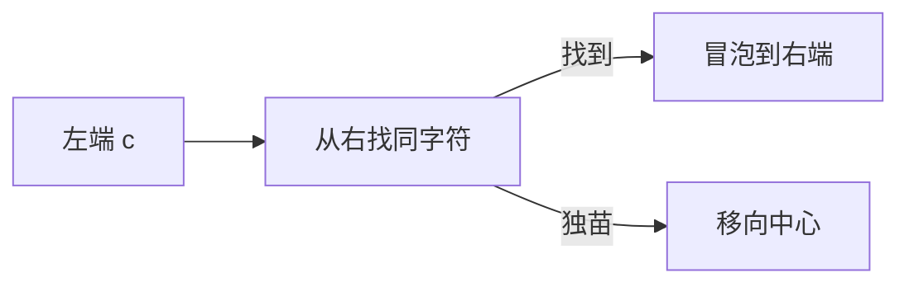

# LC 2193. Minimum Number of Moves to Make Palindrome

> Hard · [LeetCode](https://leetcode.com/problems/minimum-number-of-moves-to-make-palindrome/) · Tags: Two Pointers, String, Greedy

## 题意

相邻交换使字符串变成回文，返回最少交换次数（保证可行）。

## 最优思路

从外向内：固定左端字符，从右找匹配并冒泡到右端，代价为距离。若无匹配（奇数个中心字符），代价为移到中心的距离 `n//2 - i`。

## 图解

## 复杂度

| 项 | 值 |
|----|----|
| 时间 | \(O(n^2)\) |
| 空间 | \(O(n)\) |

## 代码

见 `2193.minimum-number-of-moves-to-make-palindrome.py`。
