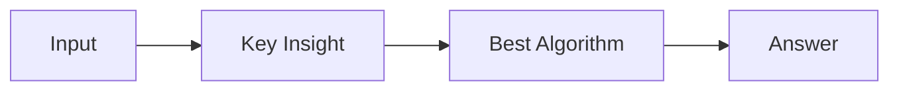

# LC 2203. Minimum Weighted Subgraph With the Required Paths

> Hard · [LeetCode](https://leetcode.com/problems/minimum-weighted-subgraph-with-the-required-paths/) · Tags: Graph Theory, Heap (Priority Queue), Shortest Path

## 题意

（待补：一句话题意）

## 最优思路

（待补：最优解核心 intuition）

## 图解

## 复杂度

| 项 | 值 |
|----|----|
| 时间 | TBD |
| 空间 | TBD |

## 代码

见同目录 `2203.minimum-weighted-subgraph-with-the-required-paths.py`。

## 参考

- https://leetcode.com/problems/minimum-weighted-subgraph-with-the-required-paths/
