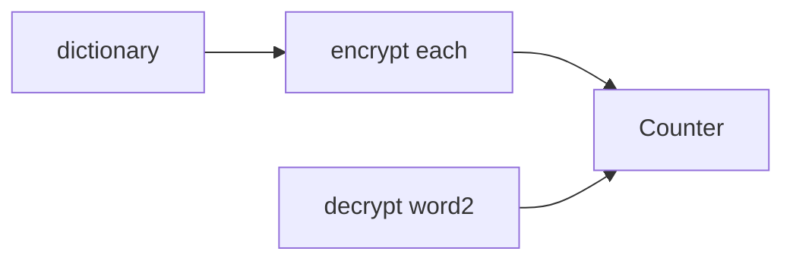

# LC 2227. Encrypt and Decrypt Strings

> Hard · [LeetCode](https://leetcode.com/problems/encrypt-and-decrypt-strings/) · Tags: Array, Hash Table, String, Design, Trie

## 题意

字母→两字符映射加密；解密统计字典中有多少词加密后等于给定串。

## 最优思路

预计算字典中每词加密结果频次；解密 \(O(1)\) 查表。

## 图解

## 复杂度

| 项 | 值 |
|----|----|
| 初始化 | \(O(\sum |w|)\) |
| decrypt | \(O(1)\) |

## 代码

见 `2227.encrypt-and-decrypt-strings.py`。
