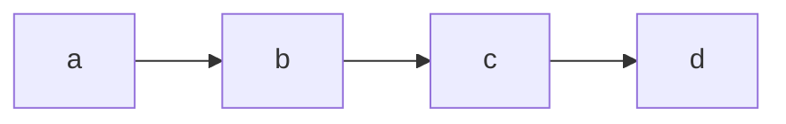

# LC 2242. Maximum Score of a Node Sequence

> Hard · [LeetCode](https://leetcode.com/problems/maximum-score-of-a-node-sequence/) · Tags: Array, Graph, Enumeration

## 题意

无向图节点有分数，求长度为 4 的简单路径 `a-b-c-d` 的最大分数和；不存在返回 `-1`。

## 最优思路

路径中间必是一条边 `b-c`。每个点只保留分数最高的 3 个邻居；枚举每条边为中间，再从两端邻居中挑互不相同的 `a,d`。

## 图解



```text
每点 top-3 邻居 → 枚举边 b-c → 选 a≠d≠b,c
```

## 复杂度

| 项 | 值 |
|----|----|
| 时间 | \(O(n+m)\) |
| 空间 | \(O(n)\) |

## 代码

见 `2242.maximum-score-of-a-node-sequence.py`。
