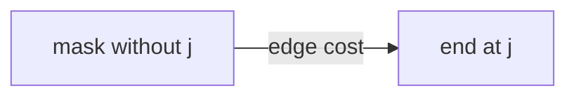

# LC 2247. Maximum Cost of Trip With K Highways

> Hard · [LeetCode](https://leetcode.com/problems/maximum-cost-of-trip-with-k-highways/) · Tags: Dynamic Programming, Bit Manipulation, Graph Theory, Bitmask

## 题意

n 座城市（n≤15）与双向收费公路，求恰好经过 k 条边、每城至多一次的最大费用；无解返回 -1。

## 最优思路

状压 DP：`f[mask][j]` 表示访问集合 mask、终点 j 的最大费用；转移枚举边。

## 图解

## 复杂度

| 项 | 值 |
|----|----|
| 时间 | \(O(2^n n^2)\) |
| 空间 | \(O(2^n n)\) |

## 代码

见同目录 `2247.maximum-cost-of-trip-with-k-highways.py`。

## 参考

- https://leetcode.com/problems/maximum-cost-of-trip-with-k-highways/
