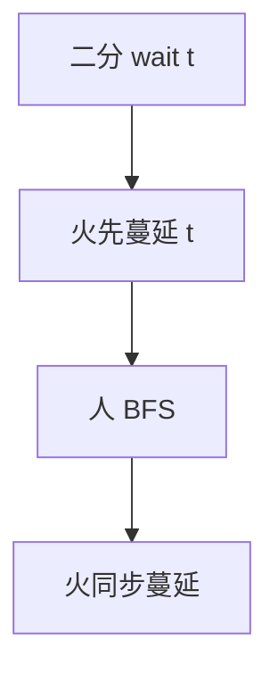

# LC 2258. Escape the Spreading Fire

> Hard · [LeetCode](https://leetcode.com/problems/escape-the-spreading-fire/) · Tags: Array, BFS, Binary Search, Matrix

## 题意

从左上到右下，每分钟人先走一步，火再蔓延。求出发前最多可等待分钟数；不可能 `-1`；可无限等返回 \(10^9\)。到达终点时与火同时可算安全。

## 最优思路

答案关于等待时间单调，二分 `t`。先蔓延火 `t` 分钟，再人与火同步 BFS：人只能进未着火格子；迈向终点时若该格尚无着火则成功（终点允许“刚到就着”）。

## 图解

## 复杂度

| 项 | 值 |
|----|----|
| 时间 | \(O(mn\log(mn))\) |
| 空间 | \(O(mn)\) |

## 代码

见 `2258.escape-the-spreading-fire.py`。
