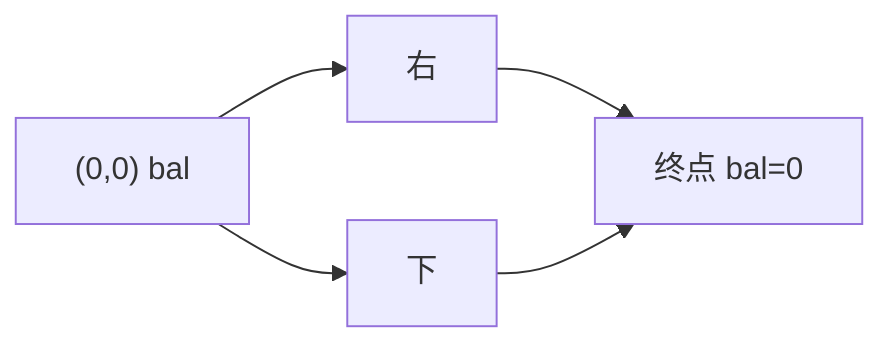

# LC 2267. Check if There Is a Valid Parentheses String Path

> Hard · [LeetCode](https://leetcode.com/problems/check-if-there-is-a-valid-parentheses-string-path/) · Tags: Array, DP, DFS, Matrix

## 题意

网格仅含 `(`/`)`，只能向右/下，从左上到右下的路径是否能形成合法括号串。

## 最优思路

路径长 `m+n-1` 须为偶数；起止字符须匹配。记忆化 `dfs(i,j,bal)`：更新括号余额，`bal<0` 或超过剩余步数剪枝，终点要求 `bal==0`。

## 图解

## 复杂度

| 项 | 值 |
|----|----|
| 时间 | \(O(mn(m+n))\) |
| 空间 | \(O(mn(m+n))\) |

## 代码

见 `2267.check-if-there-is-a-valid-parentheses-string-path.py`。
