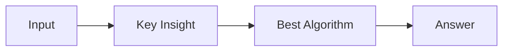

# LC 2267.  Check if There Is a Valid Parentheses String Path

> Hard · [LeetCode](https://leetcode.com/problems/check-if-there-is-a-valid-parentheses-string-path/) · Tags: Array, Dynamic Programming, Matrix, Bracket Sequences

## 题意

（待补：一句话题意）

## 最优思路

（待补：最优解核心 intuition）

## 图解

## 复杂度

| 项 | 值 |
|----|----|
| 时间 | TBD |
| 空间 | TBD |

## 代码

见同目录 `2267.check-if-there-is-a-valid-parentheses-string-path.py`。

## 参考

- https://leetcode.com/problems/check-if-there-is-a-valid-parentheses-string-path/
