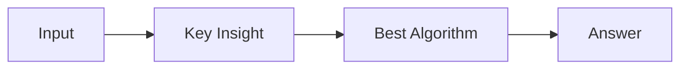

# LC 2313. Minimum Flips in Binary Tree to Get Result

> Hard · [LeetCode](https://leetcode.com/problems/minimum-flips-in-binary-tree-to-get-result/) · Tags: Dynamic Programming, Tree, Depth-First Search, Binary Tree

## 题意

（待补：一句话题意）

## 最优思路

（待补：最优解核心 intuition）

## 图解

## 复杂度

| 项 | 值 |
|----|----|
| 时间 | TBD |
| 空间 | TBD |

## 代码

见同目录 `2313.minimum-flips-in-binary-tree-to-get-result.py`。

## 参考

- https://leetcode.com/problems/minimum-flips-in-binary-tree-to-get-result/
