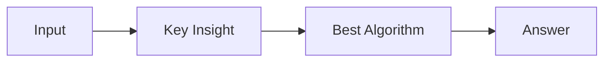

# LC 2328. Number of Increasing Paths in a Grid

> Hard · [LeetCode](https://leetcode.com/problems/number-of-increasing-paths-in-a-grid/) · Tags: Array, Dynamic Programming, Depth-First Search, Breadth-First Search, Graph Theory, Topological Sort, Memoization, Matrix

## 题意

（待补：一句话题意）

## 最优思路

（待补：最优解核心 intuition）

## 图解

## 复杂度

| 项 | 值 |
|----|----|
| 时间 | TBD |
| 空间 | TBD |

## 代码

见同目录 `2328.number-of-increasing-paths-in-a-grid.py`。

## 参考

- https://leetcode.com/problems/number-of-increasing-paths-in-a-grid/
