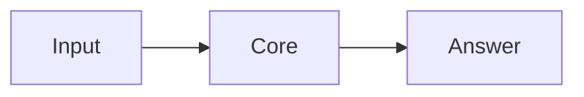

# LC 2459. Sort Array by Moving Items to Empty Space

> Hard · [LeetCode](https://leetcode.com/problems/sort-array-by-moving-items-to-empty-space/)

## 题意

用空位交换排序，两种目标形态取最小。

## 最优思路

环/模拟交换。

## 图解

## 复杂度

| 项 | 值 |
|----|----|
| 时间 | O(n) |
| 空间 | O(n) |
