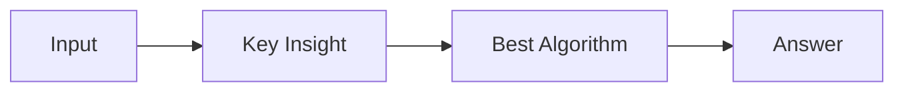

# LC 2479. Maximum XOR of Two Non-Overlapping Subtrees

> Hard · [LeetCode](https://leetcode.com/problems/maximum-xor-of-two-non-overlapping-subtrees/) · Tags: Tree, Depth-First Search, Graph Theory, Trie

## 题意

（待补：一句话题意）

## 最优思路

（待补：最优解核心 intuition）

## 图解

## 复杂度

| 项 | 值 |
|----|----|
| 时间 | TBD |
| 空间 | TBD |

## 代码

见同目录 `2479.maximum-xor-of-two-non-overlapping-subtrees.py`。

## 参考

- https://leetcode.com/problems/maximum-xor-of-two-non-overlapping-subtrees/
