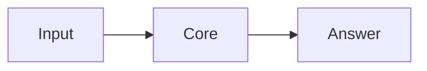

# LC 2479. Maximum XOR of Two Non-Overlapping Subtrees

> Hard · [LeetCode](https://leetcode.com/problems/maximum-xor-of-two-non-overlapping-subtrees/)

## 题意

两棵不相交子树 XOR 最大。

## 最优思路

子树 XOR + 祖先后代剔除枚举/ Trie。

## 图解

## 复杂度

| 项 | 值 |
|----|----|
| 时间 | O(n²) |
| 空间 | O(n) |
