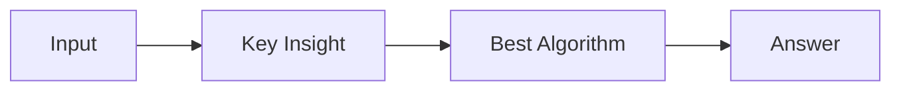

# LC 2508. Add Edges to Make Degrees of All Nodes Even

> Hard · [LeetCode](https://leetcode.com/problems/add-edges-to-make-degrees-of-all-nodes-even/) · Tags: Hash Table, Graph Theory

## 题意

（待补：一句话题意）

## 最优思路

（待补：最优解核心 intuition）

## 图解

## 复杂度

| 项 | 值 |
|----|----|
| 时间 | TBD |
| 空间 | TBD |

## 代码

见同目录 `2508.add-edges-to-make-degrees-of-all-nodes-even.py`。

## 参考

- https://leetcode.com/problems/add-edges-to-make-degrees-of-all-nodes-even/
