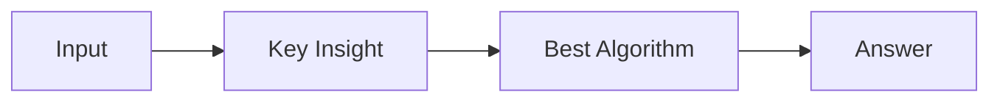

# LC 2509. Cycle Length Queries in a Tree

> Hard · [LeetCode](https://leetcode.com/problems/cycle-length-queries-in-a-tree/) · Tags: Array, Tree, Binary Tree, Binary Lifting, Lowest Common Ancestor

## 题意

（待补：一句话题意）

## 最优思路

（待补：最优解核心 intuition）

## 图解

## 复杂度

| 项 | 值 |
|----|----|
| 时间 | TBD |
| 空间 | TBD |

## 代码

见同目录 `2509.cycle-length-queries-in-a-tree.py`。

## 参考

- https://leetcode.com/problems/cycle-length-queries-in-a-tree/
