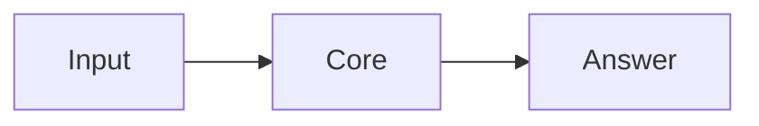

# LC 2519. Count the Number of K-Big Indices

> Hard · [LeetCode](https://leetcode.com/problems/count-the-number-of-k-big-indices/)

## 题意

左右各有 ≥k 个更小元素的下标个数。

## 最优思路

双向树状数组。

## 图解

## 复杂度

| 项 | 值 |
|----|----|
| 时间 | O(n log n) |
| 空间 | O(n) |
