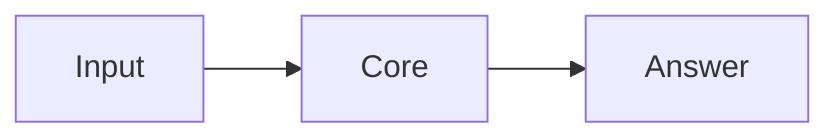

# LC 2524. Maximum Frequency Score of a Subarray

> Hard · [LeetCode](https://leetcode.com/problems/maximum-frequency-score-of-a-subarray/)

## 题意

定长子数组频率得分 max(sum v^freq)。

## 最优思路

滑窗维护幂次贡献。

## 图解

## 复杂度

| 项 | 值 |
|----|----|
| 时间 | O(n log MOD) |
| 空间 | O(n) |
