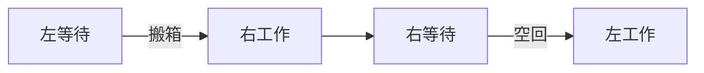

# LC 2532. Time to Cross a Bridge

> Hard · [LeetCode](https://leetcode.com/problems/time-to-cross-a-bridge/) · Tags: Array, Heap (Priority Queue), Simulation

## 题意

工人过桥搬箱：效率低者优先过桥；右岸优先于左岸。求最后一箱运到左岸时间。

## 最优思路

四堆模拟：左右等待（按效率）、左右工作。当前时刻能过桥则过，否则跳到下一完成时刻。

## 图解

## 复杂度

| 项 | 值 |
|----|----|
| 时间 | \(O(n\log k)\) |
| 空间 | \(O(k)\) |

## 代码

见 `2532.time-to-cross-a-bridge.py`。
