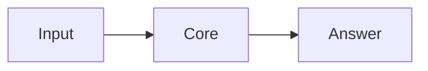

# LC 2604. Minimum Time to Eat All Grains

> Hard · [LeetCode](https://leetcode.com/problems/minimum-time-to-eat-all-grains/)

## 题意

母鸡同时吃光谷物的最少时间。

## 最优思路

排序后二分时间，双指针分配谷物段。

## 图解

## 复杂度

| 项 | 值 |
|----|----|
| 时间 | O((n+m) log U) |
| 空间 | O(1) |
