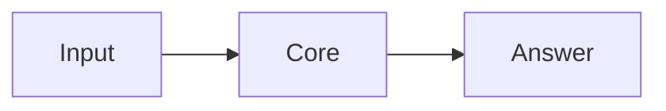

# LC 2613. Beautiful Pairs

> Hard · [LeetCode](https://leetcode.com/problems/beautiful-pairs/)

## 题意

曼哈顿距离最近的点对（下标最小）。

## 最优思路

分治最近点对。

## 图解

## 复杂度

| 项 | 值 |
|----|----|
| 时间 | O(n log n) |
| 空间 | O(n) |
