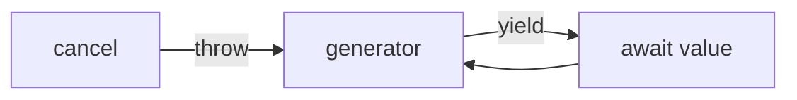

# LC 2650. Design Cancellable Function

> Hard · [LeetCode](https://leetcode.com/problems/design-cancellable-function/) · Tags: —

## 题意

（原题为 JS）包装 async generator：返回 `cancel` 与 Promise；cancel 时向 generator `throw("Cancelled")`。

## 最优思路

驱动 `next/send/throw`；竞态取消则 `generator.throw`。Python 侧用同步驱动 + `Cancelled` 异常模拟。

## 图解

## 复杂度

| 项 | 值 |
|----|----|
| 时间 | \(O(\text{yield 次数})\) |
| 空间 | \(O(1)\) 额外 |

## 代码

见 `2650.design-cancellable-function.py`。
