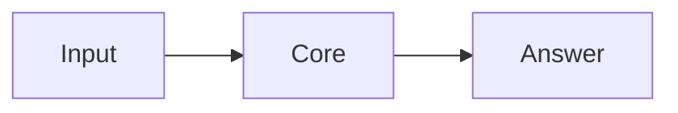

# LC 2675. Array of Objects to Matrix

> Hard · [LeetCode](https://leetcode.com/problems/array-of-objects-to-matrix/)

## 题意

对象数组展平为矩阵。

## 最优思路

递归扁平化键；列排序。

## 图解

## 复杂度

| 项 | 值 |
|----|----|
| 时间 | 见代码 |
| 空间 | 见代码 |
