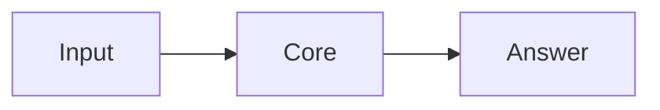

# LC 2701. Consecutive Transactions with Increasing Amounts

> Hard · [LeetCode](https://leetcode.com/problems/consecutive-transactions-with-increasing-amounts/)

## 题意

客户连续≥3天金额递增的区间。

## 最优思路

岛屿问题 / 窗口 LAG。

## 图解

## 复杂度

| 项 | 值 |
|----|----|
| 时间 | 见代码 |
| 空间 | 见代码 |
