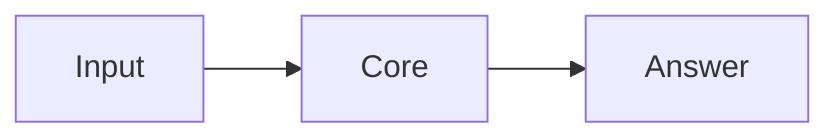

# LC 2702. Minimum Operations to Make Numbers Non-positive

> Hard · [LeetCode](https://leetcode.com/problems/minimum-operations-to-make-numbers-non-positive/)

## 题意

全体减 y、其一再减 x−y，变非正最少次。

## 最优思路

二分次数 + 贪心额外刀。

## 图解

## 复杂度

| 项 | 值 |
|----|----|
| 时间 | O(n log M) |
| 空间 | O(1) |
