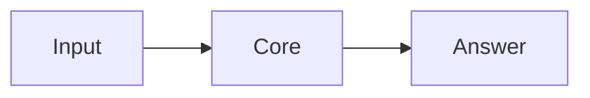

# LC 2714. Find Shortest Path with K Hops

> Hard · [LeetCode](https://leetcode.com/problems/find-shortest-path-with-k-hops/)

## 题意

最多 k 次免费跳边的最短路。

## 最优思路

状态 Dijkstra (点,已跳次数)。

## 图解

## 复杂度

| 项 | 值 |
|----|----|
| 时间 | O(Ek log) |
| 空间 | O(nk) |
