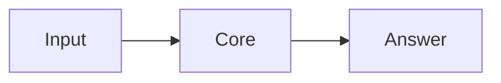

# LC 2752. Customers with Maximum Number of Transactions on Consecutive Days

> Hard · [LeetCode](https://leetcode.com/problems/customers-with-maximum-number-of-transactions-on-consecutive-days/)

## 题意

最长连续交易日上的交易数。

## 最优思路

日期岛屿 + 聚合。

## 图解

## 复杂度

| 项 | 值 |
|----|----|
| 时间 | 见代码 |
| 空间 | 见代码 |
