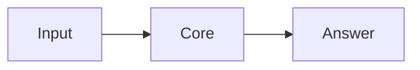

# LC 2753. Count Houses in a Circular Street II

> Hard · [LeetCode](https://leetcode.com/problems/count-houses-in-a-circular-street-ii/)

## 题意

环街 Street API 数房子。

## 最优思路

关门清场后标记开门绕圈。

## 图解

## 复杂度

| 项 | 值 |
|----|----|
| 时间 | O(n) |
| 空间 | O(1) |
