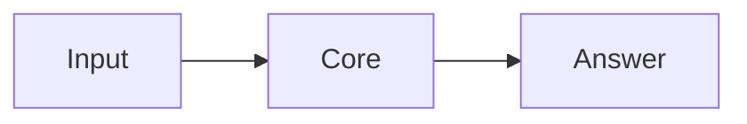

# LC 2756. Query Batching

> Hard · [LeetCode](https://leetcode.com/problems/query-batching/)

## 题意

查询批处理合并 key。

## 最优思路

节流窗口合并请求。

## 图解

## 复杂度

| 项 | 值 |
|----|----|
| 时间 | 见代码 |
| 空间 | 见代码 |
