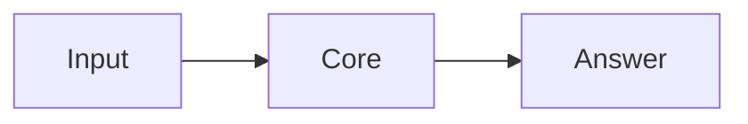

# LC 2759. Convert JSON String to Object

> Hard · [LeetCode](https://leetcode.com/problems/convert-json-string-to-object/)

## 题意

手写 JSON 解析（禁 JSON.parse）。

## 最优思路

递归下降。

## 图解

## 复杂度

| 项 | 值 |
|----|----|
| 时间 | O(n) |
| 空间 | O(n) |
