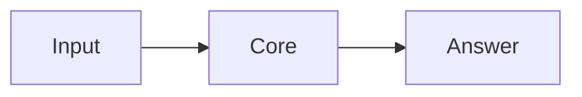

# LC 2792. Count Nodes That Are Great Enough

> Hard · [LeetCode](https://leetcode.com/problems/count-nodes-that-are-great-enough/)

## 题意

子树中至少 k 个更小节点的结点个数。

## 最优思路

DFS 合并 k 最小堆。

## 图解

## 复杂度

| 项 | 值 |
|----|----|
| 时间 | O(n k) |
| 空间 | O(n k) |
