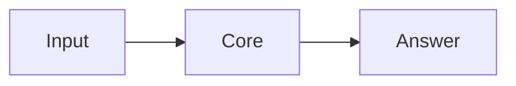

# LC 2814. Minimum Time Takes to Reach Destination Without Drowning

> Hard · [LeetCode](https://leetcode.com/problems/minimum-time-takes-to-reach-destination-without-drowning/)

## 题意

避开洪水到终点最少秒。

## 最优思路

水多源 BFS + 人 BFS。

## 图解

## 复杂度

| 项 | 值 |
|----|----|
| 时间 | O(nm) |
| 空间 | O(nm) |
