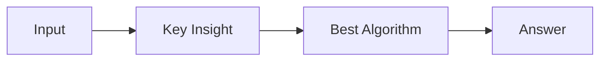

# LC 2842. Count K-Subsequences of a String With Maximum Beauty

> Hard · [LeetCode](https://leetcode.com/problems/count-k-subsequences-of-a-string-with-maximum-beauty/) · Tags: Hash Table, Math, String, Greedy, Sorting, Combinatorics, Fermat's Little Theorem

## 题意

（待补：一句话题意）

## 最优思路

（待补：最优解核心 intuition）

## 图解

## 复杂度

| 项 | 值 |
|----|----|
| 时间 | TBD |
| 空间 | TBD |

## 代码

见同目录 `2842.count-k-subsequences-of-a-string-with-maximum-beauty.py`。

## 参考

- https://leetcode.com/problems/count-k-subsequences-of-a-string-with-maximum-beauty/
