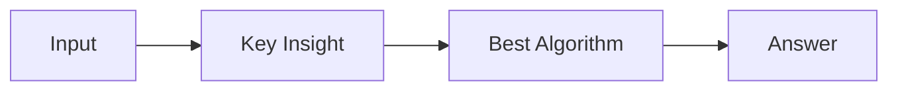

# LC 2876. Count Visited Nodes in a Directed Graph

> Hard · [LeetCode](https://leetcode.com/problems/count-visited-nodes-in-a-directed-graph/) · Tags: Dynamic Programming, Depth-First Search, Graph Theory, Topological Sort, Memoization, Kosaraju's Algorithm, Tarjan's SCC Algorithm

## 题意

（待补：一句话题意）

## 最优思路

（待补：最优解核心 intuition）

## 图解

## 复杂度

| 项 | 值 |
|----|----|
| 时间 | TBD |
| 空间 | TBD |

## 代码

见同目录 `2876.count-visited-nodes-in-a-directed-graph.py`。

## 参考

- https://leetcode.com/problems/count-visited-nodes-in-a-directed-graph/
