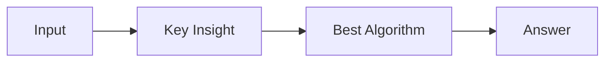

# LC 2902. Count of Sub-Multisets With Bounded Sum

> Hard · [LeetCode](https://leetcode.com/problems/count-of-sub-multisets-with-bounded-sum/) · Tags: Array, Hash Table, Dynamic Programming, Sliding Window, Knapsack Problem, Multiple Knapsack

## 题意

（待补：一句话题意）

## 最优思路

（待补：最优解核心 intuition）

## 图解

## 复杂度

| 项 | 值 |
|----|----|
| 时间 | TBD |
| 空间 | TBD |

## 代码

见同目录 `2902.count-of-sub-multisets-with-bounded-sum.py`。

## 参考

- https://leetcode.com/problems/count-of-sub-multisets-with-bounded-sum/
