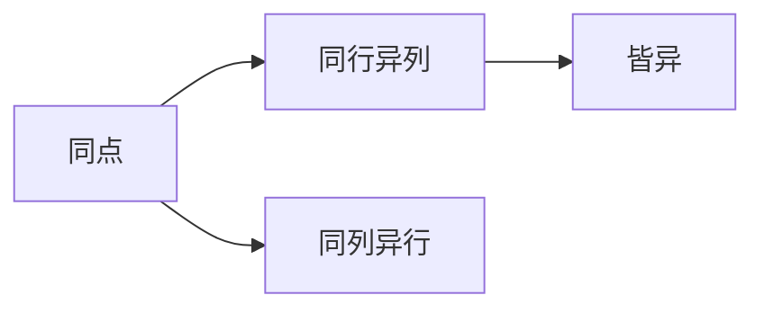

# LC 2912. Number of Ways to Reach Destination in the Grid

> Hard · [LeetCode](https://leetcode.com/problems/number-of-ways-to-reach-destination-in-the-grid/) · Tags: Math, Dynamic Programming, Combinatorics

## 题意

`n×m` 网格上走 `k` 步（四向），从 source 到 dest 的方案数模 \(10^9+7\)。

## 最优思路

四状态 DP：相对终点的行列是否相同，按步转移。

## 图解

## 复杂度

| 项 | 值 |
|----|----|
| 时间 | \(O(k)\) |
| 空间 | \(O(1)\) |

## 代码

见 `2912.number-of-ways-to-reach-destination-in-the-grid.py`。
