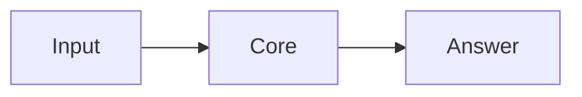

# LC 2916. Subarrays Distinct Element Sum of Squares II

> Hard · [LeetCode](https://leetcode.com/problems/subarrays-distinct-element-sum-of-squares-ii/)

## 题意

所有子数组 distinct² 之和。

## 最优思路

线段树维护扩展时 distinct 增量。

## 图解

## 复杂度

| 项 | 值 |
|----|----|
| 时间 | O(n log n) |
| 空间 | O(n) |
