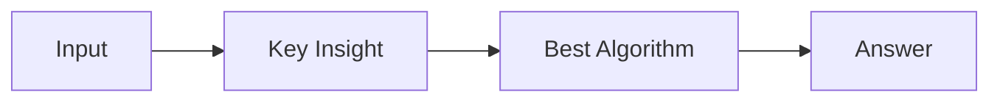

# LC 2916. Subarrays Distinct Element Sum of Squares II

> Hard · [LeetCode](https://leetcode.com/problems/subarrays-distinct-element-sum-of-squares-ii/) · Tags: Array, Hash Table, Binary Indexed Tree, Segment Tree

## 题意

（待补：一句话题意）

## 最优思路

（待补：最优解核心 intuition）

## 图解

## 复杂度

| 项 | 值 |
|----|----|
| 时间 | TBD |
| 空间 | TBD |

## 代码

见同目录 `2916.subarrays-distinct-element-sum-of-squares-ii.py`。

## 参考

- https://leetcode.com/problems/subarrays-distinct-element-sum-of-squares-ii/
