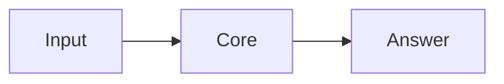

# LC 2921. Maximum Profitable Triplets With Increasing Prices II

> Hard · [LeetCode](https://leetcode.com/problems/maximum-profitable-triplets-with-increasing-prices-ii/)

## 题意

价格递增三元组利润和最大。

## 最优思路

树状数组维护左右最大利润。

## 图解

## 复杂度

| 项 | 值 |
|----|----|
| 时间 | 见代码 |
| 空间 | 见代码 |
